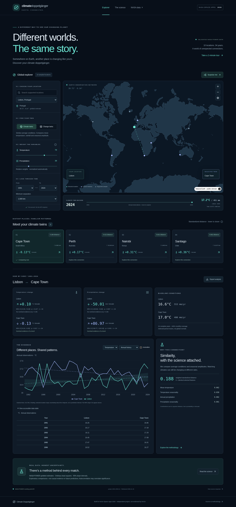

# Climate Doppelgänger

**Different worlds. The same story.** A NASA Space Apps Challenge 2026 project exploring geographically distant places with similar climates—or similar environmental changes despite different climates.

> **Data status:** Authentic NASA POWER observations cover 10 locations, 1991–2024. The data gate passes, and both matching modes reproduce independent SciPy calculations. The submission package has been checked against the project submission guide supplied by the owner; live official pages still return HTTP 503. Registration, personal declarations and final portal submission remain human actions.

## The problem

Average climate does not tell the whole story of environmental change. Two distant places can have different temperatures and rainfall yet experience comparable trends. Climate Doppelgänger makes that distinction visible, with interpretable statistical evidence rather than arbitrary similarity percentages or unsupported AI claims.

The user-supplied challenge is [Be An Earth System Trend Detective!](https://www.spaceappschallenge.org/2026/challenges/earth-system-trend-detective/). This is an independent project, not endorsed by NASA.

## Implemented features

- **Climate twins:** compare average temperature, annual rainfall and seasonal amplitude.
- **Change twins:** compare per-decade trends and detrended interannual variability.
- **Global explorer:** MapLibre map with local public-domain land geometry, supported-point selection, twin highlights and connections. Accessible location search/selection works without WebGL.
- **Transparent matching:** adjustable temperature/rainfall weights, geographic separation filters and feature contributions to standardized distance.
- **Comparison dashboard:** annual temperature and precipitation histories, OLS fits, 95% slope intervals, nominal p-values, sample sizes and completeness.
- **Anomalies and seasonality:** annual anomalies, calendar-month anomalies and seasonal cycles with interactive charts and accessible data tables.
- **Discovery and timeline:** deterministic distant-pair discovery, selected-year values and selected-period recomputation.
- **Methodology explorer:** formulas, uncertainty, data sources and limitations; comparison JSON export includes provenance and parameters.
- **Static deployment architecture:** no backend, accounts, database, paid AI or runtime NASA request.
- **Python ingestion:** bounded sequential downloads, retries, local caching, strict validation, atomic compact export and raw-source hashes.

These features have been exercised with the included authentic observations as well as separately labelled synthetic fixtures. The [reproducible demo](docs/demo.md) shows Lisbon selecting Cape Town as its Climate Twin and Reykjavík as its Change Twin at default weights, with explicit statistical uncertainty. No award or completed submission is claimed.



[View the mobile explorer screenshot](docs/images/authentic-mobile.png). Both screenshots use the included authentic snapshot.

## Scientific approach

The verified source is NASA POWER monthly T2M (°C) and PRECTOTCORR (mm/day), covering 1991–2024 at 10 validated points including Vancouver and Langley, BC. Seventeen coordinates are available in the pipeline, but only the first 10 are included in this snapshot. Live responses confirmed parameter schema, units and coverage.

Monthly temperatures are day-weighted into annual means; rainfall rates are multiplied by calendar-month days and summed into annual mm. OLS estimates per-decade trends, Student-t slope intervals and two-sided nominal p-values. Each matching feature is standardized across the selected-period sample cohort. A weighted Euclidean distance gives an explainable ranking; lower is closer and zero means identical selected features. It is not a probability or percent match.

See [methodology](docs/methodology.md) and [data sources](docs/data-sources.md) for formulas, parameter expectations, source attribution and regeneration. Similarity is not correlation, significance, causation or prediction. Serial correlation and multiple testing can overstate nominal significance. Curated points do not represent global coordinate coverage.

## Technology

React, strict TypeScript, Vite, Tailwind CSS, MapLibre GL JS, Recharts and Lucide React. Python preprocessing uses NumPy, Pandas and SciPy. Vitest, React Testing Library, Playwright, Pytest, Ruff and Mypy provide checks. Dependencies are repository-scoped; npm has an integrity lockfile and Python has a version-pinned requirements file.

## Get started

Use the existing Node.js 24 environment (NVM on Bazzite/KDE). Do not install global packages or modify the host OS.

```bash
npm ci
npm run dev
```

The included `public/data/climate.json` makes the demonstration work without contacting NASA. To regenerate it, use a local Python environment and permitted access to `power.larc.nasa.gov`:

```bash
python3 -m venv .venv
.venv/bin/python -m pip install -r requirements-lock.txt
.venv/bin/python -m pip install --no-deps -e .
.venv/bin/python -m pipeline.generate --limit 1 --download-only  # inspect first real response
.venv/bin/python -m pipeline.generate            # validate the default 10 points
```

No credentials are expected. Run `npm run data:check` after regeneration. Never substitute generated numbers when retrieval fails. See [development](docs/development.md) for cloud cache settings and [data sources](docs/data-sources.md) for verified provenance and reproducible acquisition.

## Checks

```bash
npm test
npm run test:coverage
npm run typecheck
npm run lint
npm run build
.venv/bin/python -m pytest
.venv/bin/python -m ruff check pipeline tests
.venv/bin/python -m mypy pipeline
.venv/bin/python -m pip check
```

Browser tests use explicitly labelled synthetic fixtures and the committed authentic snapshot, without live NASA calls:

```bash
npx --no-install playwright install chromium
npm run test:e2e
# Codex Cloud already has Chromium:
CHROMIUM_PATH=/usr/bin/chromium npm run test:e2e
```

Tests verify calculations, validation failures, changing modes/weights/periods, search, map rendering, charts, discovery, timeline, modal keyboard behavior and responsive width. Passing fixture tests alone does not validate real NASA observations. GitHub Actions is configured for Node 24 and Python 3.11/3.13; revision-specific evidence is recorded in the [submission checklist](submission/final-checklist.md). See [authentic-data verification](docs/authentic-data-verification.md).

## Architecture and deployment

`src/core` owns science and matching; `src/data` validates external data; `src/components` renders maps/charts; `src/hooks` loads the dataset; `pipeline` creates static observations; `tests` holds deterministic and browser checks. See [architecture](docs/architecture.md).

Cloudflare Pages can build with `npm run build` and serve `dist`. No deployment has been performed or authorized. Production headers are supplied in `public/_headers`. Commit the validated compact dataset before publishing a demonstration. Raw API caches and build outputs stay ignored.

## Security and limitations

No secrets belong in browser bundles. Inputs are validated, data is never evaluated as code, React renders text, and the basemap has no third-party tile requirement. See [security policy](SECURITY.md) for private reporting, dependency review and supply-chain boundaries.

This is exploratory analysis, not forecasting, attribution or policy advice. POWER grid cells may not represent local terrain/coasts; annual aggregation hides extremes. Only temperature and precipitation are implemented. Autocorrelation-aware inference, extra NASA variables and broader sampling are future work. Only the 10 validated points in this snapshot are supported observations; the seven additional curated coordinates require separate acquisition and validation.

## Contributing and licensing

See [CONTRIBUTING.md](CONTRIBUTING.md), [AGENTS.md](AGENTS.md), the [Code of Conduct](CODE_OF_CONDUCT.md) and the [demo guide](docs/demo.md).

The application retains the [MIT License](LICENSE), Copyright (c) 2026 Will Xu. Selected official Everything Claude Code skills are vendored under `.agents/skills` with ECC's MIT notice and a revision/hash manifest in [.agents/ecc](.agents/ecc/README.md). Use them only when relevant; no hooks, MCPs or global ECC installation are configured. Natural Earth geometry is public domain. Credit NASA POWER, NASA Langley Research Center for any successfully acquired environmental data; preserve parameter-specific citations in response metadata. No NASA endorsement is implied.

See [the network diagnosis](docs/network-diagnosis.md) and [portable local acquisition/offline import](docs/local-data-transfer.md). The earlier policy mismatch is resolved in the published instance; NASA POWER now responds successfully. The offline workflow remains available as a fallback.

## Submission review

See the [final readiness checklist](docs/submission-readiness.md), [submission-form drafts](docs/submission-form.md), and [review description](docs/pull-request.md). The owner's supplied guide establishes the demo limits, form fields and submission schedule used by this package; it has not been independently authenticated against the unavailable live 2026 pages. Local verification, hosted CI and official submission are separate states.

## Submission package

The [submission package](submission/README.md) contains the required [seven-slide Project Demo](submission/presentation/climate-doppelganger.pdf), editable PPTX, authentic application screenshots, extended supporting recording, submission text, attribution, and deployment handoff. Team: **Team Name Team**; member: **William Xu**. The supplied Universal Event deadline is November 15, 2026, 11:59 p.m. America/Vancouver (November 16, 06:59 UTC). See [rule evidence](submission/requirements.md) and the [human-action checklist](submission/final-checklist.md). [SI-development disclosure](submission/si-disclosure.json) identifies Codex-assisted code, tests, documents and layout; NASA observations and captured media are authentic, with no generative imagery.
